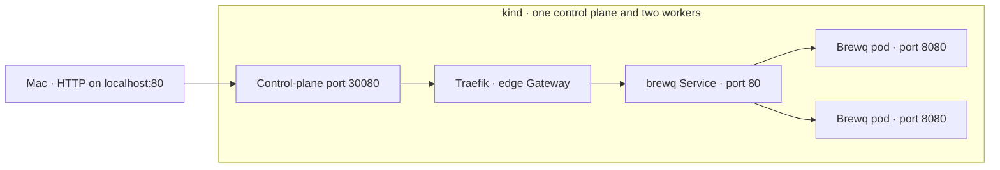

# Brewq on Kubernetes

This repo runs Brewq, a small coffee-order service, in a local kind cluster.
It installs Traefik and metrics-server and ships the Helm chart used by the GitOps repo.



## In the series

1. [brewq-service](https://github.com/Mythicc123/brewq-service) builds the Go service and publishes its container image.
2. **brewq-k8s** runs the service in a local cluster.
3. [brewq-observability](https://github.com/Mythicc123/brewq-observability) adds dashboards, SLOs and alerts.
4. [brewq-gitops](https://github.com/Mythicc123/brewq-gitops) manages deployments with Argo CD and documents failure drills.

## Prerequisites

- Docker Desktop running on macOS, with local TCP port 80 available.
- Bash, Make, curl, kind 0.33.0, Helm 4 and kubectl v1.37.0.
  The kind configuration pins the Kubernetes v1.37.0 node image by digest.
- kubeconform 0.8.0 for `make lint`.
- Internet access for public charts, container images and `localtest.me` DNS.

The chart and the `kind-e2e` CI job use the published image
`ghcr.io/mythicc123/brewq-service:0.1.0`.

## Quick start

```sh
make up
make deploy
make smoke
make test
```

`make up` uses an existing `brewq` kind cluster if present. Helm and kubectl
target the `kind-brewq` context and use the configured `KUBECONFIG`.
`make smoke` checks the public menu and version routes and submits a sample order.
`make test` checks `/readyz` and `/menu` through the in-cluster Service.
Run `make status` to inspect the cluster and `make down` when you finish using it.
For a local service build, tag it as `ghcr.io/mythicc123/brewq-service:0.1.0`
and run `make load-image` before `make deploy` on a fresh cluster.

## Local routes

The hostnames resolve to loopback. Every HTTPRoute attaches to
`traefik/edge`, which accepts routes from all namespaces in this local lab.

| Hostname | Backend | Defined in |
| --- | --- | --- |
| `brewq.localtest.me` | Brewq | brewq-k8s |
| `grafana.localtest.me` | Grafana | brewq-observability |
| `prometheus.localtest.me` | Prometheus | brewq-observability |
| `alertmanager.localtest.me` | Alertmanager | brewq-observability |
| `argocd.localtest.me` | Argo CD | brewq-gitops |

## Design decisions

- **Gateway API.** Traefik serves one shared Gateway with a route per app.
  Gateway API is the successor to Ingress, and Ingress NGINX was retired in March 2026.
  [Kubernetes retirement announcement](https://kubernetes.io/blog/2025/11/11/ingress-nginx-retirement/)
- **Rollouts and disruption.** `maxUnavailable: 0` and `maxSurge: 1` keep
  ready pods serving while a replacement starts. The rollout needs space for
  an extra pod. When a pod is removed, a five-second pre-stop hook keeps
  the server available while Traefik picks up the endpoint change. The
  20-second termination grace period also covers the server's ten-second
  request drain. A PDB asks voluntary evictions to leave at least one pod
  available. Soft topology spread favours separate worker nodes when capacity allows.
- **CPU and autoscaling.** The CPU request reserves capacity and gives the HPA
  a utilisation baseline. Omitting a CPU limit lets the service use spare CPU
  during bursts and avoids quota throttling. It can compete for CPU under
  contention. The HPA needs metrics-server to read pod CPU use. In this local
  cluster, metrics-server skips verification of kubelet serving certificates.
- **Order state.** Each pod stores its own queue in memory. A request that lands
  on another pod may miss an order, and deleting a pod discards its queue.

## Cost: $0

The cluster runs on Docker Desktop with public images and uses no cloud
resources. Allow roughly 4–6 GiB of Docker memory for the three nodes and the
base platform. This is a planning estimate and varies with workload and Docker
settings. `make down` deletes the cluster.

## Next steps

Add the observability stack, then bootstrap Argo CD and run the failure drills.
A shared PostgreSQL or Redis store would let replicas share order state.
